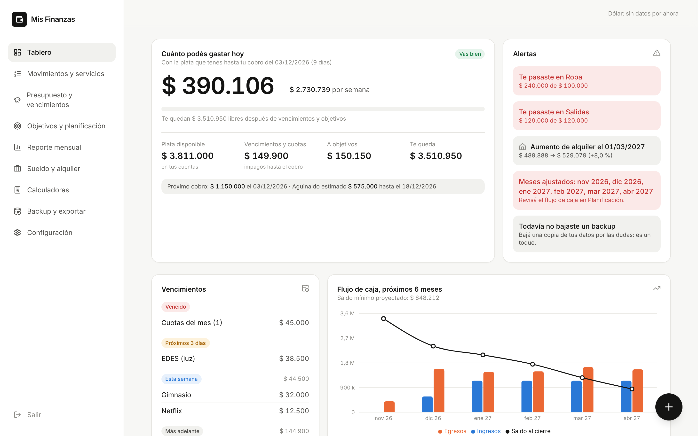
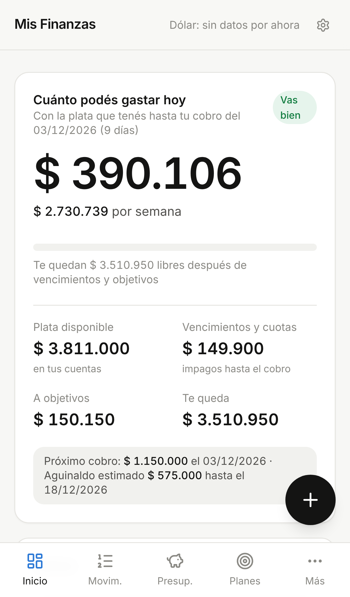
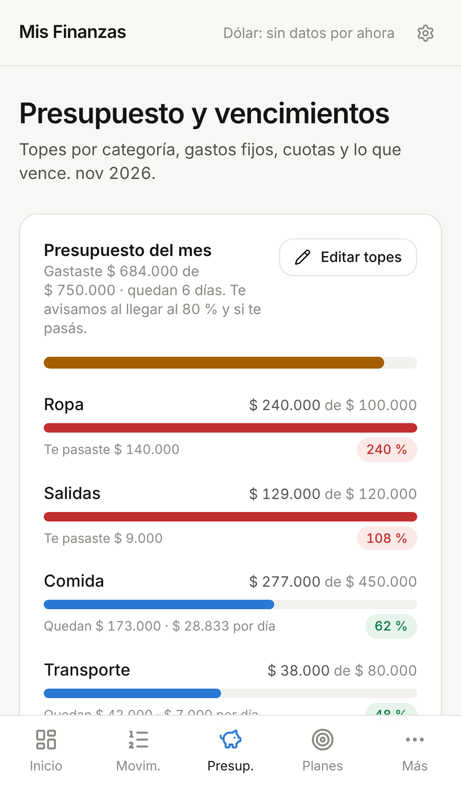
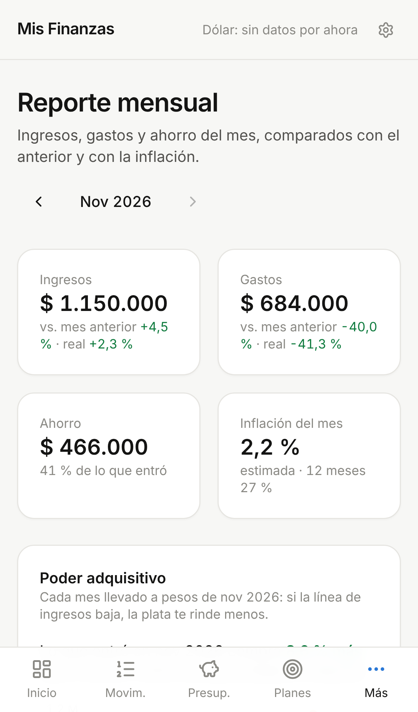
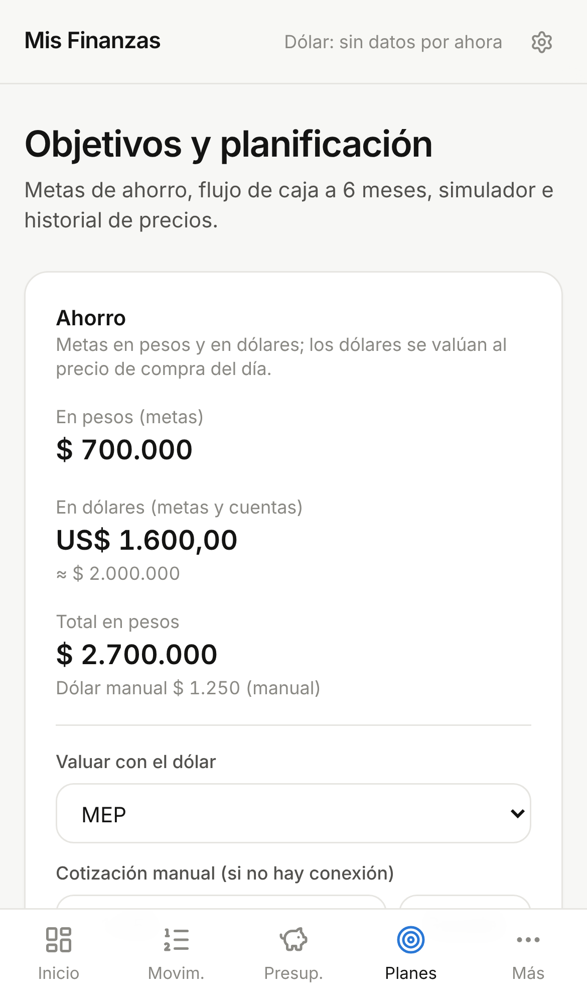

<div align="center">

# 💸 Mis Finanzas

**Tus finanzas personales, en pesos argentinos y con la inflación en cuenta.**

Cuánto podés gastar hoy, qué vence esta semana, cuánto te queda de cada presupuesto,
qué cuotas pagás en los próximos meses y si tu sueldo le gana a la inflación.
Se instala en el celu y en la compu como una app (PWA) y funciona sin conexión.




</div>

---

## En el celu

<p align="center">
  
  
  
  
</p>

<p align="center"><sub>Inicio · Presupuesto · Reporte mensual · Ahorro en dólares</sub></p>

## Qué hace

### 📊 Día a día
- **Cuánto podés gastar hoy**: con la plata de tus cuentas hasta el próximo cobro, ya descontados vencimientos, cuotas y aportes a objetivos.
- **Movimientos**: gastos e ingresos cargados en segundos, siempre con la cuenta de donde sale la plata. Se pueden editar y borrar, y se cargan aunque no haya señal: se guardan y se sincronizan después.
- **Cuentas**: banco, billetera virtual, efectivo, tarjeta, en pesos o en dólares, cada una con su saldo.
- **Transferencias entre cuentas**: de la billetera al banco, retiros de efectivo, y compra o venta de dólares con el tipo de cambio de la operación. No cuentan como gasto ni como ingreso.
- **Gastos compartidos**: la parte que te deben y lo que ya te devolvieron.

### 🗓️ Presupuesto y vencimientos
- **Presupuesto mensual por categoría**, con aviso al llegar al 80 % y otro si te pasás.
- **Gastos fijos y suscripciones** (gimnasio, Netflix, seguro), con frecuencia mensual, trimestral o anual. Al pagar uno se crea el próximo.
- **Servicios** (EDES, Camuzzi, BVC, Personal): se cargan leyendo el PDF de la boleta, gratis.
- **"Lo pago más adelante"**: el gasto queda como vencimiento y no te descuenta plata hoy.
- **Cuotas de tarjeta** proyectadas a 12 meses, según el día de cierre y de vencimiento de cada tarjeta.
- **Avisos push** de cada vencimiento con los días de anticipación que elijas, a las 8 de la mañana.

### 💼 Sueldo y alquiler
- **Estimador de sueldo** del convenio de Empleados de Comercio (CCT 130/75): antigüedad, presentismo, aportes y aguinaldo proporcional.
- **"Es mi sueldo"**: al cargar el cobro se precarga el estimado, y se guarda un historial de sueldos.
- **Recibos de sueldo** leídos desde el PDF, con el detalle línea por línea.
- **Alquiler**: el próximo aumento por ICL, IPC o porcentaje fijo, según el contrato.

### 🎯 Planificación y ahorro
- **Objetivos** en pesos o en dólares, con aporte mensual y fecha meta.
- **Ahorro total** con los dólares valuados al tipo de cambio del día (MEP, oficial, blue, cripto o CCL), o a uno cargado a mano.
- **Flujo de caja a 6 meses**, que marca los meses ajustados.
- **Simulador de escenarios**, **contado vs. cuotas** con inflación, e **historial de precios**.

### 📈 Reporte mensual
- Ingresos, gastos y ahorro del mes, comparados con el mes anterior en pesos y descontada la inflación.
- **Poder adquisitivo**: cada mes llevado a pesos de hoy, para ver si la plata te rinde más o menos.
- Gastos por categoría con su variación real, y sueldos ajustados por IPC.

### 🔒 Tus datos
- **Backup completo** en un archivo (opcionalmente con los PDF y fotos), y **restauración** con revisión previa y doble confirmación. Si algo falla a mitad de camino, vuelve a como estaba.
- **Exportación a Excel** con 8 hojas (movimientos, servicios, cuotas, cuentas, transferencias, objetivos, sueldos y resumen mensual), y CSV compatible con Excel en español.
- Aviso en el inicio si pasó más de un mes sin backup.
- Todo protegido con contraseña.

## Stack

| | |
|---|---|
| **App** | [Next.js 16](https://nextjs.org) (App Router, Server Components) + TypeScript |
| **UI** | Tailwind CSS v4, componentes propios estilo shadcn/ui, íconos [Lucide](https://lucide.dev), gráficos [Recharts](https://recharts.org) |
| **Datos** | PostgreSQL en [Neon](https://neon.tech) con [Drizzle ORM](https://orm.drizzle.team) y migraciones SQL |
| **Validación** | [Zod](https://zod.dev) en cada endpoint |
| **PWA** | Service worker propio (shell offline y cola de carga), manifest, Web Push con VAPID |
| **Lectura de PDFs** | [unpdf](https://github.com/unjs/unpdf) gratis, con lectura opcional por IA ([Claude](https://www.anthropic.com/claude)) para fotos |
| **Excel** | SpreadsheetML generado a mano y comprimido con [fflate](https://github.com/101arrowz/fflate), sin dependencias pesadas |
| **Tests** | [Vitest](https://vitest.dev) con [PGlite](https://pglite.dev) (Postgres en memoria con las mismas migraciones) |
| **Deploy** | [Vercel](https://vercel.com), con un cron diario para los avisos |

## Probarla en tu compu

Necesitás **Node 20 o más nuevo**.

```bash
git clone https://github.com/thiagoaffede/finanzas-pwa.git
cd finanzas-pwa
npm install
cp .env.example .env.local
npm run dev            # http://localhost:3000
```

Sin `DATABASE_URL` la app arranca con **datos de ejemplo** y no guarda nada: sirve para mirarla.
Para usarla en serio, conectá una base (abajo).

### Con base de datos

1. Creá un proyecto gratis en [Neon](https://neon.tech) y copiá la *connection string*.
   También sirve cualquier Postgres local.
2. Pegala en `DATABASE_URL` dentro de `.env.local` (ese archivo no se sube al repo).
3. Aplicá las migraciones con `npm run db:migrate`.
4. Entrá a **Configuración** y cargá:
   - tu puesto, la escala de Comercio vigente y los índices (IPC/ICL);
   - en **Cuentas**, tus cuentas con su saldo.

### Scripts

| Comando | Qué hace |
|---|---|
| `npm run dev` | Servidor de desarrollo |
| `npm test` | Tests (lógica financiera y repositorio contra Postgres en memoria) |
| `npm run typecheck` | Chequeo de tipos |
| `npm run lint` | ESLint |
| `npm run db:generate -- --name algo` | Genera una migración nueva a partir de `src/lib/db/schema.ts` |
| `npm run db:migrate` | Aplica las migraciones pendientes |
| `npm run db:studio` | Explorador de la base (Drizzle Studio) |

## Publicarla en Vercel

1. Importá el repo en [Vercel](https://vercel.com/new). Detecta Next.js solo.
2. En **Settings → Environment Variables** cargá las variables de abajo. Marcá las claves como *Sensitive*.
3. Deploy. El build (`vercel-build`) aplica las migraciones pendientes antes de compilar, así que
   cada cambio de base se publica solo.
4. Abrila en el celu y elegí **Agregar a inicio** (iPhone) o **Instalar app** (Android y compu).
   En iPhone, los avisos push funcionan solo con la app agregada a inicio.

### Variables de entorno

| Variable | | Para qué |
|---|---|---|
| `DATABASE_URL` | **obligatoria** | Conexión a Neon (o a cualquier Postgres). |
| `APP_PASSWORD` | **obligatoria** | La contraseña para entrar. Sin ella la app queda abierta. |
| `AUTH_SECRET` | recomendada | Texto largo al azar para firmar la sesión. Cambiarlo cierra todas las sesiones. |
| `VAPID_PUBLIC_KEY`, `VAPID_PRIVATE_KEY` | para avisos | Claves de Web Push: `npx web-push generate-vapid-keys`. |
| `VAPID_SUBJECT` | para avisos | Tu mail (`mailto:...`) o la URL `https://` de la app. Apple rechaza dominios inventados. |
| `CRON_SECRET` | para avisos | Protege el cron diario de `vercel.json` (`/api/cron/due-alerts`, 8 a. m. hora argentina). |
| `ANTHROPIC_API_KEY` | opcional, paga | Lectura con IA de fotos de boletas y recibos. Sin ella, los PDF digitales se leen gratis. |
| `EXTRACTION_MODEL` | opcional | Modelo para esa lectura. |
| `DOLLAR_API_URL`, `DOLLAR_CACHE_MINUTES` | opcional | De dónde se toman las cotizaciones del dólar y cada cuánto se refrescan. |

Todas están documentadas, sin valores, en [`.env.example`](.env.example).
**Nunca subas credenciales al repo**: van en `.env.local` o en las variables de Vercel.

## Cómo está armada

```
src/
├── app/(app)/          Pantallas: inicio, movimientos, presupuesto, planificación, reporte,
│                       sueldo y alquiler, calculadoras, backup, configuración
├── app/api/            API REST (todas detrás del login), cron de avisos, export y backup
├── proxy.ts            Pide sesión en páginas y API
├── components/         ui/ (base), forms/, charts/, dashboard/, layout/
└── lib/
    ├── finance/        Lógica pura y testeada: cuánto gastar, sueldo, alquiler, cuotas,
    │                   presupuesto, flujo de caja, reporte con inflación
    ├── data/           Repositorio (consultas Drizzle) y el contexto que alimenta las pantallas
    ├── db/             Esquema y conexión (Neon HTTP en producción, pg en local)
    ├── parsers/        Lectura de boletas y recibos desde el texto del PDF
    ├── extraction/     Lectura opcional con IA
    ├── market/         Cotización del dólar con caché
    ├── backup.ts       Backup y restauración
    └── xlsx.ts         Generador de Excel
drizzle/                Migraciones SQL (se aplican en cada deploy)
public/sw.js            Service worker
docs/                   Reglas de negocio y capturas
```

Decisiones de fondo:
- **Plata en centavos enteros** y fechas `YYYY-MM-DD`: nada de redondeos con decimales.
- **La lógica financiera es pura** (sin base ni red) y está cubierta por tests. Las pantallas solo arman datos y muestran.
- **Escalas salariales e índices son de referencia** hasta que cargues los vigentes. Ver [`docs/domain-rules.md`](docs/domain-rules.md).

## Seguridad

Es una app **de un solo usuario**: una contraseña protege páginas y API, y la sesión va en una cookie firmada.
Los datos viven en tu base de Neon. Las claves van solo en variables de entorno.

---

<p align="center"><sub>Hecha para uso personal en Argentina 🇦🇷</sub></p>
